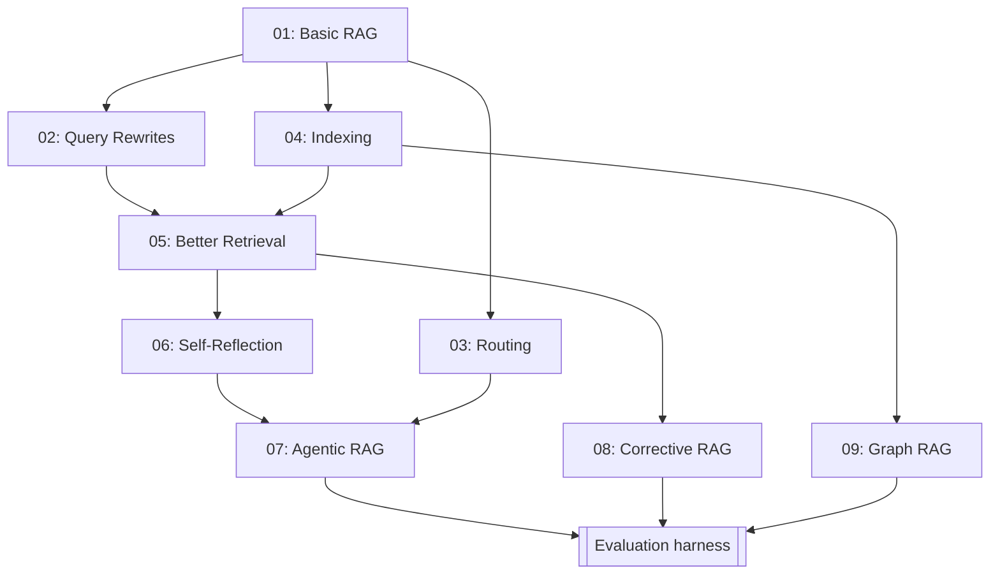
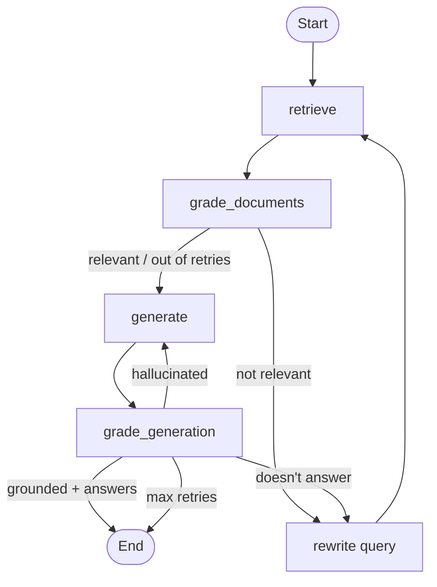

<div align="center">

# rag-basic-to-agentic

**Nine progressive RAG pipelines, from a five-line chain to a tool-using agent, plus a benchmark harness that measures what each technique actually buys you. Free-tier stack, no local model downloads.**

[](https://github.com/Suhaila-Samir-El-behairy/rag-basic-to-agentic/actions/workflows/ci.yml)
[](https://www.python.org/downloads/)
[](LICENSE)
[](https://github.com/astral-sh/ruff)

[Quick Start](#tldr) · [The Journey](#the-journey) · [Evaluation](#evaluation) · [Tech Stack](#the-free-stack) · [Usage](#usage) · [Roadmap](#roadmap)

</div>

---

## Why this project?

Most RAG tutorials either stop at "vector search + prompt" or jump straight into a 500-line LangGraph demo, and almost none of them tell you whether the fancy version is better. This repo walks the **middle path** and then **measures it**:

- **Scripts, not notebooks**: each script is runnable on its own and exposes the same `run(question) -> RAGResult` interface
- **Benchmarked**: a labelled QA set, retrieval and answer metrics, bootstrap confidence intervals, paired significance tests, and a check of how far the LLM judge can be trusted
- **Faithful to the papers, and explicit where it isn't**: CRAG uses the paper's decision rule and knowledge refinement; Graph RAG says plainly that it is *local search* only
- **Free-tier stack**: Groq + HuggingFace (+ optional LangSmith), no credit card
- **Tested offline**: 100+ tests with fake LLMs and embeddings, so CI needs no API keys

## TL;DR

```bash
git clone https://github.com/Suhaila-Samir-El-behairy/rag-basic-to-agentic.git
cd rag-basic-to-agentic
pip install -e ".[dev,eval]"
cp .env.example .env  # add GROQ_API_KEY and HUGGINGFACEHUB_API_TOKEN
ragkit 01 --question "What is task decomposition?"
ragkit eval --limit 5   # quick benchmark smoke run
```

## The Journey

Nine scripts. Each one adds one technique.

| # | Script | What it does | Technique |
|---|--------|--------------|-----------|
| 01 | `01_basic_rag.py`| Five-stage RAG: load → split → embed → retrieve → generate | Foundational pipeline |
| 02 | `02_query_transformations.py`| Four query rewriting methods to improve recall | Multi-Query, RAG-Fusion, HyDE, Step-Back |
| 03 | `03_routing.py`| LLM picks the right data source per question | Structured-output routing across vector store / web / arXiv |
| 04 | `04_indexing.py`| Compare five chunking + indexing strategies | Recursive, character, token, semantic chunking, multi-representation |
| 05 | `05_retrieval.py`| Higher-precision retrieval with reranking + hybrid | FlashRank cross-encoder, RAG-Fusion, BM25 + dense ensemble |
| 06 | `06_self_reflection.py`| RAG that critiques its own retrieval + generation | LangGraph state machine with grader nodes and bounded retry loops |
| 07 | `07_agentic_rag.py`| Tool-calling agent picks tools dynamically | Native function calling, multi-step reasoning, step budget |
| 08 | `08_corrective_rag.py` | Grade retrieval, refine it, fall back to the web when needed | CRAG (Yan et al. 2024): per-document action trigger + decompose-filter-recompose |
| 09 | `09_graph_rag.py` | Extract entities + relationships, answer from the graph | GraphRAG-style *local search* over a NetworkX knowledge graph |

## Architecture Flow



All scripts share one corpus (Lilian Weng's [LLM Powered Autonomous Agents](https://lilianweng.github.io/posts/2023-06-23-agent/)), downloaded and indexed once (`src/ragkit/corpus.py`).

## Self-Reflection Graph (Script 06)



Three graders (document relevance, hallucination, answer quality) control the flow. Rewrites change only the *search query*; generation and grading always use the user's original question. A regeneration after a hallucination uses a stricter prompt and a non-zero temperature, because at temperature 0 it would reproduce the same answer. Rewrites and regenerations are each capped at `MAX_RETRIES=2`, so the graph always terminates.

## Corrective RAG (Script 08)

| Step | Paper (Yan et al. 2024) | This repo |
|---|---|---|
| Retrieval evaluator | fine-tuned T5-large | prompted LLM returning a 0–1 score |
| Action trigger | CORRECT if **any** doc > upper; INCORRECT if **all** < lower | same (`--rule paper`, default); `--rule avg` keeps a mean-score variant for ablation |
| Knowledge refinement | decompose into strips, score each, recompose | decompose into strips, one LLM call per doc selects the relevant ones |
| Web search | keyword-rewritten query | same |

## Evaluation

```bash
ragkit eval-check                                  # verify gold evidence occurs in the corpus
ragkit eval                                        # default suite: one pipeline per technique
ragkit eval --pipelines 01:basic 08:crag 08:crag-avg-rule --run-id crag-ablation
ragkit eval-label --run results/<run_id> --n 30    # hand-label answers to validate the judge
ragkit eval-report --run results/<run_id>          # regenerate summary.md + plot
```

**Dataset** (`data/eval/agent_blog_qa.jsonl`, 40 questions):

| Category | n | What it tests |
|---|---|---|
| `single_hop` | 23 | one passage of the corpus answers it |
| `multi_hop` | 5 | needs several passages or a comparison |
| `out_of_corpus` | 6 | needs the web or arXiv; tests routing and tool use |
| `unanswerable` | 6 | the right behaviour is to say "I don't know" |

Each question has a reference answer, gold-evidence phrases, and the tool(s) an ideal agent would call.

**Metrics** (per question, then aggregated):

- **Recall@4 / MRR**: do the retrieved contexts contain the gold-evidence phrases, and how high up? This needs no LLM.
- **Correctness**: an LLM judge compares the answer with the reference. Unanswerable questions count as correct only when the system abstains.
- **Faithfulness**: an LLM judge checks that every claim in the answer is supported by the retrieved context.
- **Tool choice** (03, 07): did the router or agent pick an expected source? For 07 the report also shows how often it hit the step limit.
- **Cost**: LLM calls, tokens and latency per question, counted automatically by a callback handler (`ragkit/tracking.py`).

**Statistics:** every number is reported with a 95% bootstrap confidence interval. Each pipeline is compared with `01:basic` using a paired bootstrap over the same questions, which gives a CI and a p-value. With 40 questions, differences under about 15 points are usually not significant, and the report shows that instead of hiding it.

**Judge reliability:** LLM judges can be biased (for example, lenient toward their own model's answers). `ragkit eval-label` shows you a random sample of answers with the judge's verdict hidden. The report then gives raw agreement and **Cohen's κ** between you and the judge. Set `RAGKIT_JUDGE_MODEL` to judge with a different model than the pipelines.

**Practicalities:** a shared rate limiter keeps a run under the free-tier limit (`--rpm`, default 25/min). Judge verdicts are cached on disk, and an interrupted run resumes where it stopped (`--run-id`).

### Results

> No benchmark results are committed yet. Run `ragkit eval` with your keys, then paste `results/<run_id>/summary.md` here together with the run metadata line (model, judge, commit).

## The Free Stack

| Component | Tool | Free Tier | Local install? |
|-----------|------|-----------|----------------|
| LLM | [Groq](https://console.groq.com): Llama 3.3 70B | 30 req/min | No |
| Embeddings | [HuggingFace Inference API](https://huggingface.co): `BAAI/bge-small-en-v1.5` | rate-limited, retried with backoff | No |
| Tracing (optional) | [LangSmith](https://smith.langchain.com) | 5,000 traces/month | No |
| Reranking | [FlashRank](https://github.com/PrithivirajDamodaran/FlashRank) | Free | small model, downloaded once |
| Web search | [DuckDuckGo](https://duckduckgo.com) (or Tavily with a key) | No key | No |
| Vector store | [Chroma](https://www.trychroma.com) | Free | Local data only |

## Project Structure

```
rag-basic-to-agentic/
├── pyproject.toml          # package + tool config
├── tasks.py                # invoke task runner
├── main.py                 # CLI dispatcher (wraps ragkit.cli)
├── data/eval/              # labelled QA set
├── src/ragkit/
│   ├── cli.py              # `ragkit NN ...` and `ragkit eval ...`
│   ├── config.py           # env loading + paths
│   ├── corpus.py           # shared corpus download/split/index, cached
│   ├── pipeline.py         # RAGResult + pipeline registry
│   ├── tracking.py         # LLM call/token counting
│   ├── utils.py            # LLM/embedding factories, RRF, grounded answering
│   ├── scripts/01..09_*.py # the nine techniques, each with run() and main()
│   └── eval/               # datasets, metrics, judge, runner, report, cli
├── tests/                  # offline tests (fake LLMs + embeddings)
└── .github/workflows/ci.yml  # ruff + mypy + pytest on 3.10–3.13
```

## Installation

```bash
python -m venv .venv && source .venv/bin/activate   # Windows: .venv\Scripts\activate
pip install -e ".[dev,eval]"
cp .env.example .env
```

| Service | Sign-up | Needed for |
|---------|---------|------------|
| [Groq](https://console.groq.com) | Email → API Keys → Create | all LLM calls |
| [HuggingFace](https://huggingface.co/settings/tokens) | Settings → Tokens | embeddings |
| [LangSmith](https://smith.langchain.com) (optional) | Settings → API Keys | traces; set `LANGCHAIN_TRACING_V2=true` |

Tracing is **off by default**. Set `LANGCHAIN_TRACING_V2=true` and `LANGCHAIN_API_KEY` in `.env` to send runs to LangSmith (project `rag-basic-to-agentic`).

## Usage

```bash
ragkit 01 --question "What is task decomposition?"
ragkit 02 --question "What is task decomposition?" --method hyde
ragkit 05 --question "What is task decomposition?" --method hybrid
ragkit 07 --question "Compare ReAct and Reflexion" --verbose
ragkit 08 --question "What is MIPS?" --rule paper
ragkit 09 --question "How does ReAct relate to Reflexion?" --hops 2

# same thing via invoke
inv run -n 05 -q "What is task decomposition?" -e "--method hybrid"
```

| Script | Flag | Options |
|--------|------|---------|
| 01 | `--k` | chunks to retrieve (default 4) |
| 02 | `--method` | `multi-query`, `rag-fusion`, `hyde`, `step-back` |
| 04 | `--strategy` | `recursive`, `character`, `token`, `semantic`, `multi-rep` |
| 05 | `--method` | `basic`, `rerank`, `rag-fusion`, `hybrid` |
| 07 | `--verbose`, `--max-steps` | print the agent trace, step budget |
| 08 | `--upper`, `--lower`, `--rule`, `--no-refine` | thresholds, decision rule (`paper`/`avg`), skip refinement |
| 09 | `--hops`, `--rebuild` | subgraph radius, rebuild cached graph |

## Development

```bash
inv test     # pytest (offline, no API keys needed)
inv lint     # ruff check + mypy
inv format   # ruff format
inv clean    # remove caches + vector stores
pre-commit install   # ruff hooks from .pre-commit-config.yaml
```

## Switching Providers

```bash
pip install -e ".[gemini]"
# .env
LLM_PROVIDER=gemini
GOOGLE_API_KEY=AIza_...
```

## Troubleshooting

| Issue | Fix |
|-------|-----|
| `GROQ_API_KEY missing` | Add it to `.env`, then re-run |
| `RateLimitError` on Groq | Lower `ragkit eval --rpm`, or set `GROQ_MODEL=llama-3.1-8b-instant` |
| Stale vector store / graph | `inv clean` (or `ragkit 09 --rebuild`) |
| LangSmith traces missing | Set `LANGCHAIN_TRACING_V2=true` and `LANGCHAIN_API_KEY` |
| Semantic chunking slow | It embeds every sentence once; the result is cached afterwards |

## Roadmap

- [x] `src/` package, CLI, invoke tasks, CI (ruff, mypy, pytest, Python 3.10–3.13)
- [x] Offline tests for every script
- [x] Common `run()` interface + LLM cost tracking
- [x] Evaluation harness: retrieval + judged metrics, bootstrap CIs, paired tests, judge calibration
- [ ] Commit benchmark results and a short write-up of the findings
- [ ] Public benchmark (e.g. a HotpotQA / MultiHop-RAG subset) with a pluggable corpus
- [ ] Learned router that picks a pipeline per question from cost/quality trade-offs
- [ ] Streamlit side-by-side demo and FastAPI endpoints

## Inspiration & Credits

The technique sequence follows [NisaarAgharia/Advanced_RAG](https://github.com/NisaarAgharia/Advanced_RAG) and [NisaarAgharia/RAG_From_Scratch](https://github.com/NisaarAgharia/RAG_From_Scratch). Credit for the original notebooks and diagrams goes to those authors. This repo reimplements them as scripts on a free cloud stack and adds the evaluation harness. Papers: CRAG ([Yan et al. 2024](https://arxiv.org/abs/2401.15884)), GraphRAG ([Edge et al. 2024](https://arxiv.org/abs/2404.16130)), RAG-Fusion/RRF ([Cormack et al. 2009](https://plg.uwaterloo.ca/~gvcormac/cormacksigir09-rrf.pdf)), HyDE ([Gao et al. 2022](https://arxiv.org/abs/2212.10496)), Step-Back ([Zheng et al. 2023](https://arxiv.org/abs/2310.06117)), ReAct ([Yao et al. 2022](https://arxiv.org/abs/2210.03629)).

## License

MIT — see [LICENSE](LICENSE).
